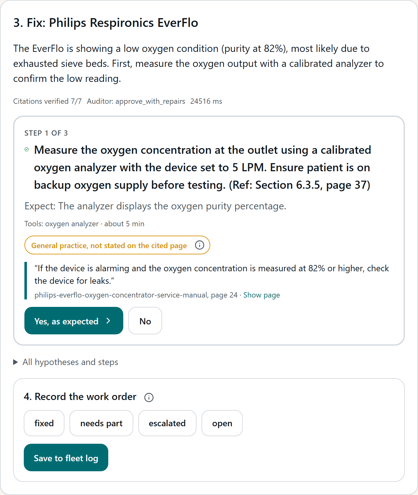
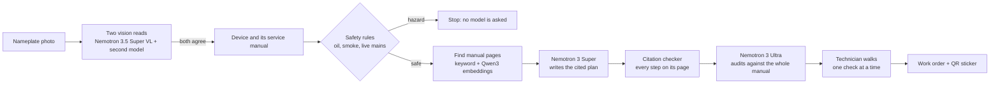

# Sieve

[](https://github.com/usv240/sieve/actions/workflows/ci.yml) [](LICENSE)

**Photograph a broken oxygen concentrator and get a repair plan from its own service manual, every step cited to its page and audited, in under a minute.**

Built on **Nebius Token Factory** with **NVIDIA Nemotron 3 Nano, 3 Super, 3 Ultra, 3.5 Lightning and 3.5 Super VL**. Physical AI track. Apache-2.0.

> **Four years broken. A few hours to fix.** At Chintheche Health Center in Malawi, four oxygen concentrators sat broken for four years. A repair team with the right knowledge had all four running again in a few hours ([OpenO2](https://www.openo2.org/concentrator-graveyard)). Replacing them would have cost $2,000 to $6,400 ([UNICEF](https://www.unicef.org/supply/media/2916/file/_Oxygen-Concentrator-TPP-v1.pdf)). Sieve puts that knowledge in every technician's hand, for about 5 to 7 US cents of model calls per repair plan.



## Try it in two minutes (no sign-up, no key)

| What to try | Link | What you will see |
|---|---|---|
| A real repair, live | [EverFlo yellow light](https://sieve-kappa.vercel.app/try?sample=everflo-yellow): click **Identify**, then **Build the fix** | A step-by-step plan where every step quotes its manual page, an Ultra audit, and every model call with its cost |
| A safety stop | [Ask to oil the compressor](https://sieve-kappa.vercel.app/try?sample=hazard-oil) | A fixed rule stops it before any model is asked: oil near oxygen starts fires |
| The results | [Evals page](https://sieve-kappa.vercel.app/evals) | 69.7 percent on the prior work's own questions; 62 of 62 fire reports taken out of service |
| Your own manual | [Data page](https://sieve-kappa.vercel.app/data) | Upload any service manual PDF and ask it a question; the answer cites your pages |
| Your own AI agent | Add `https://sieve-api.vercel.app/mcp` as a remote MCP server in Claude, Cursor or VS Code | Four tools, no install: `list_devices`, `identify_device`, `diagnose`, `read_manual_page` |

Web: https://sieve-kappa.vercel.app. API: https://sieve-api.vercel.app (OpenAPI docs at [`/docs`](https://sieve-api.vercel.app/docs)). Demo video: https://youtu.be/VW17Trdu8rA

## Why it matters

Hospital equipment in low- and middle-income countries rarely fails for lack of parts. It fails for lack of knowledge.

- **38.3 percent** of hospital devices across 16 low- and middle-income countries are out of service ([Perry and Malkin, 2011](https://pubmed.ncbi.nlm.nih.gov/21597999/)).
- **72 percent** of 2,849 repair requests in 60 hospitals were fixed without any imported parts ([Malkin and Keane, 2010](https://link.springer.com/article/10.1007/s11517-010-0630-1)).
- **Two-thirds** of sub-Saharan countries have at most one biomedical engineer per million people ([WHO data, 2017](https://link.springer.com/article/10.1007/s10439-017-1897-2)).
- Equipment **without a service manual was 55 percent less likely to work** in Ethiopian public hospitals ([Sewagegn et al., 2025](https://link.springer.com/article/10.1007/s44250-025-00312-9)).
- Only **2 of 57** hospital oxygen concentrators tested in southwest Nigeria were fit for use, and staff named lack of maintenance knowledge among the causes ([Bakare, Graham et al., 2020](https://pmc.ncbi.nlm.nih.gov/articles/PMC6964224/)).
- When hospitals in Papua New Guinea gained working oxygen, **deaths of children with pneumonia fell by 35 percent** ([Duke et al., Lancet 2008](https://pubmed.ncbi.nlm.nih.gov/18708248/)).

The full reference list is on the live site at [/references](https://sieve-kappa.vercel.app/references).

## What it does

1. **Photograph the machine.** Two different vision models read the nameplate. Sieve opens a manual only when both agree.
2. **Answer three safety questions.** Smoke, sparks or a connected patient stop everything first.
3. **Get the fix.** Sieve finds the right pages in the real service manual and writes a step-by-step plan. Every step quotes the page it came from.
4. **Walk it one check at a time.** The technician says what they see; Sieve picks the next check.
5. **Stay safe.** Oil near oxygen, live mains and smoke are blocked by fixed rules, not by the AI.
6. **Get a second opinion.** Nemotron 3 Ultra reads the entire manual in one call and audits the plan.
7. **Check recalls and parts.** openFDA recalls and known failure patterns are checked; Tavily finds the part, or finds a manual when Sieve has none.
8. **Close the job.** The repair becomes a work order and a QR sticker for the machine. The next technician scans it and starts from this history.

It also runs **offline** on a laptop GPU with NVIDIA Nemotron Nano, and has a fleet view, a weekly fleet brief and a Training Mode simulator.

## Architecture



**The design rule: AI reads and drafts; rules decide.** The registry, the rules engine and the citation checker decide what reaches the technician. A step whose quote is not found on its page is replaced by the page itself.

| Stage | Model or tool | Where it runs |
|---|---|---|
| Nameplate reading | `nvidia/Nemotron-3.5-Super-VL`, cross-checked by `openbmb/MiniCPM-V-4_5` | Nebius Token Factory |
| Intake and extraction | `nvidia/NVIDIA-Nemotron-3-Nano-30B-A3B` | Nebius Token Factory |
| Repair plan | `nvidia/nemotron-3-super-120b-a12b` | Nebius Token Factory |
| Whole-manual audit | `nvidia/Nemotron-3-Ultra-550b-a55b` (1M-token context) | Nebius Token Factory |
| Weekly fleet brief (140,000 tokens, about one cent) | `nvidia/Nemotron-3_5-Lightning` | Nebius Token Factory |
| Search embeddings | `Qwen/Qwen3-Embedding-8B` over 2,994 concentrator pages, fused with full-text search over all 9,462 | Nebius Token Factory |
| Offline mode | `NVIDIA-Nemotron-Nano-9B-v2` (4-bit) and `NVIDIA-Nemotron-Nano-12B-v2-VL` via llama.cpp | Laptop RTX 4070, 8 GB |
| Parts, manual discovery | Tavily search, extract and map | Tavily API |
| Recalls | openFDA recalls and MAUDE reports (CC0) | Snapshot in `data/external` |

Every call is written to a ledger (model, tokens, US dollars, seconds) and shown in the app's Trace panel.

**Nebius AI Cloud.** A Serverless Endpoint served NVIDIA Nemotron Nano 12B v2 VL with vLLM on one L40S for photo reading ([`infra/endpoint-vl/RUN.md`](infra/endpoint-vl/RUN.md)). A Serverless Job cloned the repository, ran every test and called the live API, PASS in about 3 minutes ([`infra/job-verify/RUN.md`](infra/job-verify/RUN.md)).

**Agents.** Sieve is a hosted MCP server (above) and a local MCP server with 8 tools (`apps/mcp/sieve_mcp.py`). Hermes Agent calls those tools on Nemotron 3 Super and runs a scheduled FDA recall watch (`infra/hermes`). A full diagnosis also ran inside an NVIDIA OpenShell sandbox holding only credential placeholders ([`infra/openshell/DEMONSTRATED.md`](infra/openshell/DEMONSTRATED.md)), and Hermes ran in an NVIDIA NemoClaw sandbox ([`infra/nemoclaw/DEMONSTRATED.md`](infra/nemoclaw/DEMONSTRATED.md)).

## Results

All measured on data the team did not write. Every number, its raw output file and the command that reruns it are in [EVIDENCE.md](EVIDENCE.md).

| Test | Result |
|---|---|
| The closest prior work's own 300 repair questions ([INGENZI, arXiv 2601.16967](https://arxiv.org/abs/2601.16967)), blind judge | **Sieve 69.7 percent**, plain retrieval 62.0, model alone 17.0. A second judge from another model family agreed (kappa 0.94) |
| 62 real FDA reports of concentrators that smoked, burned or caught fire (pre-registered in [`eval/PREREG-benchmark-b.md`](eval/PREREG-benchmark-b.md)) | **62 of 62** taken out of service before any step was shown |
| 57 real-world photos from resale listings and product pages | **Never picked a wrong device**; identified 100 percent of concentrators with a legible model name; refused all 16 look-alikes it has no manual for |
| Citations, on ten fixed cases | **100 percent** of citations resolve to their manual page, against 88.8 percent when the model copied quotes |
| Safety controls | Hazards gated 20 of 20, false stops 0 of 10, unknown devices refused 10 of 10 |
| Accessibility | Lighthouse accessibility 100 on every page |

## Run it locally

You need Python 3.12+, [uv](https://docs.astral.sh/uv/) and Node 20+.

```bash
git clone https://github.com/usv240/sieve && cd sieve
cp .env.example .env        # add NEBIUS_API_KEY and TAVILY_API_KEY
make setup                  # install Python packages
make test                   # 39 tests, no key needed
make fetch-corpus           # download the public service manuals (not redistributed)
make ingest                 # build the search index, about 30 seconds
make dev                    # API on http://localhost:8000, docs at /docs
cd apps/web && npm install && npm run dev   # web on http://localhost:3000
```

Other commands:

- `make eval` reruns the evaluation and writes `eval/results/latest.json`.
- `make smoke` makes one real Token Factory call per model tier and prints tokens and cost.
- `make offline` starts the offline model on a local GPU (see `scripts/offline.ps1`).

Without a Nebius key the app still identifies devices, retrieves pages, applies the safety rules and checks recalls; the plan and the audit need Token Factory.

## Repository

| Path | What it holds |
|---|---|
| `apps/api` | FastAPI service, hosted MCP endpoint |
| `apps/web` | Next.js web app |
| `apps/mcp` | Local MCP server |
| `packages/core` | The repair pipeline |
| `packages/rules` | Safety rules (`sieve.yaml`) and the rules engine |
| `packages/retrieval` | Manual ingestion and hybrid search |
| `packages/llm` | Token Factory client, model router and cost ledger |
| `packages/vision` | Two-reader photo identification |
| `packages/eval` | Benchmarks; results in `eval/results` |
| `infra` | Nebius Serverless Job and Endpoint, Hermes, OpenShell, NemoClaw |
| `tests` | Test suite, run in CI on every push |

More: [EVIDENCE.md](EVIDENCE.md) (every number and how to rerun it), [FEEDBACK.md](FEEDBACK.md) (our notes on Nebius and NVIDIA tools), [DEPLOY.md](DEPLOY.md) (how the live site is deployed).

## Prior work

INGENZI Tech ([arXiv 2601.16967](https://arxiv.org/abs/2601.16967)) built a text chatbot over an ultrasound manual. Sieve adds photo identification, deterministic safety rules, an independent whole-manual audit, recall checks, work orders, offline mode, and an evaluation on INGENZI's own published questions.

## Licence and data

Apache-2.0. Service manuals are manufacturer copyright: they are indexed locally for search, quoted in short spans with page numbers, and never redistributed. openFDA data is CC0. The INGENZI dataset is CC BY-NC 4.0 (attribution INGENZI Tech).
